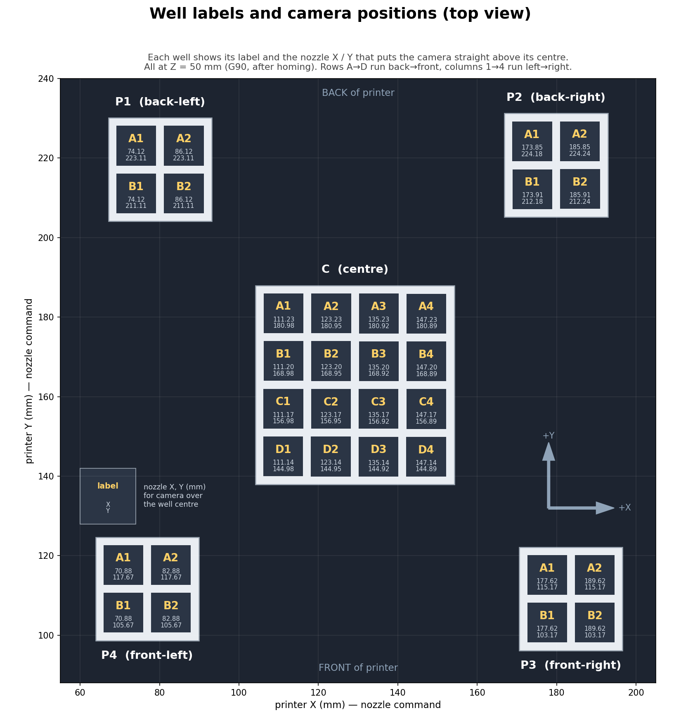

# Model Hardware API Specification

## Overview

This document specifies the command-line interface an AI agent uses to run experiments on the device. The agent works with **wells**, not with a printer, a camera, a grid or an operator.

- **The agent only knows wells.** A well is a label such as `P3-A1`. The agent does not know where the well is, how the camera gets there, or who fills it. The label's prefix names the well's island, but no command depends on the layout. Every command that reads a well moves the camera there, centers it straight above the well, captures a fresh frame, and returns data about that one well.
- **The agent is always in the loop.** There is no batch or "run" command. To follow a reaction over time, the agent calls `get_image` / `get_raw_opacity` well after well, as often as it decides, and sets the temperature when it decides. Pacing, well order, and when to stop are the agent's choices.
- **The hardware owns everything physical:** homing, motion, speed, waiting for the camera to settle, camera settings, finding the well in the frame, temperature control, operator hand-offs, safety limits, and logging.
- **Safety is enforced below the agent.** The limits, watchdogs and stop controls the service enforces are specified separately in [Hardware_Safety_spec.md](Hardware_Safety_spec.md).

## Device

- **Printer:** Bambu Lab A1, used as a hot plate and camera gantry. The bed heats the samples. Build volume 256 × 256 × 256 mm; X moves the toolhead, Y moves the bed, Z moves the gantry.
- **Well grid:** an open-bottom PETG grid on the bed ([open_grid_2mm.png](open_grid_2mm.png)). There is a 4 × 4 center island (C) and four 2 × 2 corner islands (P1–P4), 32 wells in total. Openings are 10 mm on a 12 mm pitch, and the walls are 10 mm tall. The bed surface is the floor of each well.
- **Camera:** a Raspberry Pi camera (OV5647) mounted on the toolhead next to the nozzle, looking down, tilted about 10°. It is served as an MJPEG stream; see [RASPBERRY_PI_CAMERA.md](RASPBERRY_PI_CAMERA.md).
- **Light:** a battery-powered LED bar on the toolhead. It moves with the camera, so every well is lit from the same angle when the camera is centered on it. It does not flicker, but it may dim as the battery drains.
- **Operator:** a person who fills wells with egg white and cleans them when the hardware asks. A liquid handler could take this role later without changing the API.
- **Temperature limit:** **100 °C**. Targets above it are refused. After a jump the bed overshoots its target by about 2 °C for about a minute. The bed has never been run above 80 °C on this rig.
- **Firmware:** 01.08.01.00 in LAN-only Developer Mode. Block the printer's internet access so it can't update itself; newer firmware may restrict local control.

## API Commands

### Conventions

- Each command is a CLI call that prints one JSON object. The CLI is a thin client of a hardware service that keeps the printer and camera connections open, so a call does not pay connection setup time. How the two work is under **CLI and service** below.
- Every response carries a time `t` (or `t_…`): Unix time in seconds, from the control computer's clock. Temperatures, images and operator events share this clock, so they can be aligned directly.
- Errors are returned as `{"error": "<code>", "message": "...", "t": ...}`, plus any fields that explain them (for example `bed_c` with `bed_hot`). The codes, and what the agent can do about each, are in the error table under **CLI and service**.

### 1. `get_status() -> Status`

- Reports whether the hardware is ready. It does not move anything; it reads the latest MQTT report and one frame from the open stream.
- Call it at the start of a session, or whenever the agent wants to know whether the next well read could have to home first.

```json
{
  "t": 1791747600.120,
  "ready": true,
  "homed": true,
  "printer_ok": true,
  "camera_ok": true,
  "camera_tilt_mm": [0.0, 0.04],
  "position_warning": false,
  "position_check": {"t": 1791747410.200, "max_mm": 0.12},
  "safety": "ok",
  "idle_s": 312,
  "loaded_wells": [
    {"label": "P3-A1", "t_loaded": 1791747512.400},
    {"label": "P3-A2", "t_loaded": 1791747530.150}
  ],
  "bed_c": 49.9, "target_c": 50.0, "bed_age_s": 0.8,
  "session": "2026-10-12_103012",
  "calibration_id": "2026-10-12T14:03",
  "last_operation": {
    "command": "load_well", "args": {"label": "P3-A2"}, "state": "done",
    "t_start": 1791747521.020, "t_end": 1791747530.150
  }
}
```

- `ready` is `true` when `homed`, `printer_ok` and `camera_ok` are all true, `position_warning` is false and `safety` is `ok`. When it is false, call `prepare()`. If it stays false, a person has to fix something: the agent should stop and report.
- `homed` means `home_flag & 0b111 == 0b111` in the latest printer report.
- `printer_ok`: the MQTT connection is up, a report arrived in the last 15 s (the service requests one every 5 s), `print_error` is 0 with no HMS alerts, and the printer is in its Standard speed mode. `gcode_state` is ignored: it has read `FAILED` since the grid print.
- `camera_ok`: the stream is delivering frames.
- `camera_tilt_mm` is measured on that frame, as in `get_image`. `position_warning` is true when the camera has shifted more than 0.4 mm on its mount, or when the last position check found a well more than 0.5 mm off (`position_check`, see `prepare`). The positions then need recalibration (see Recalibration); the agent cannot fix this.
- `safety` is `ok`, `heater_timeout` or `halted` (see [Hardware_Safety_spec.md](Hardware_Safety_spec.md)).
- `idle_s` is the time since the printer last moved. In three cases on 2026-10-11, the printer had lost its home 44–62 min after its last move. `load_well` doesn't move the printer, and neither does reading the well the camera is already over.
- `loaded_wells` lists the wells loaded since the last `clean_all_wells`, each with its `t_loaded`. While it is not empty, the hardware does not home on its own (see `prepare`).
- `session` names the current session folder (see **CLI and service**).
- `calibration_id` changes whenever the positions, the straight-down pixel, the tilt reference or the camera settings are recalibrated, so readings taken before and after can be told apart.
- `last_operation` is the operation running now, or the last one to finish, with its result once it is done. A caller that stopped waiting uses it to recover the result.

### 2. `prepare() -> Status`

- Makes the hardware ready and returns the same object as `get_status`. Call it at the beginning of each experiment run, before preheating and before `load_well`. It homes only if the printer has lost its home.
- If the printer is not homed, it runs the safe homing sequence (about 1 min), lifts to Z50 (confirmed before any XY move), and leaves the camera parked at X128 Y254, behind the grid.
- If the printer is already homed, it makes sure the camera is at Z50 with a Z-only move, which it skips when the service itself put the camera there, and does not move XY.
- With no wells loaded, it also starts a new session and checks the positions. It visits one well in each corner island and two in the center island, about 20 s in all, and measures how far each opening is from the straight-down point. A well more than 0.5 mm off sets `position_warning`. With wells loaded it skips both, and when nothing else needs doing it returns in under a second.
- Homing moves the bed in Y at firmware speed, which cannot be slowed down, so liquid in the wells can slosh. `prepare()` homes even when wells are loaded: after a `not_homed` error, calling it is how the agent accepts that risk.
- Fails with `homing_failed`, `printer_unavailable`, `camera_unavailable` or `halted` when it cannot make the hardware ready. If only `position_warning` is set, it returns normally with `ready: false`.

### 3. `set_temperature(temperature: float) -> {target_c, t}`

- Sets the bed target in °C and returns immediately; it does not wait for the bed to reach the target.
- `0` turns the heater off.
- Targets above 100 °C are rejected with `temperature_limit`. Negative or non-numeric targets fail with `invalid_argument`, and every target fails with `halted` while the safety stop is active.
- After a jump the bed overshoots by about 2 °C for about a minute (50 → 75 °C peaked at 76.75 °C).
- If the heater watchdog has switched the heater off (`safety: heater_timeout`), setting a temperature again resumes heating.

### 4. `get_temperature() -> {bed_c, target_c, t, age_s}`

- Returns the latest bed thermistor reading and its target.
- `age_s` is the time since the report arrived. The service requests a report every 5 s; in the trial, reports arrived a median 2.5 s apart and at most 5.2 s apart. The printer's own delay isn't included: a fan change took about 5 s to show up in its reports. While the bed heats at about 0.6 °C/s, the reading can trail it by a few degrees.
- This is the **bed** temperature, not the sample's (see Known limitations).

### 5. `get_image(label: str) -> WellImage`

- Moves the camera straight above the well, waits until the image is still, captures a fresh frame, and returns one image of the **whole cell**: the 10 mm opening plus 2 mm of the surrounding walls on each side (14 × 14 mm), enlarged so the agent can see it.
- The 7 × 7 mm square that `get_raw_opacity` measures is outlined on the image.

```json
{
  "label": "P3-A1",
  "t": 1791747635.659,
  "image": "/Users/sina/Documents/Science_Experiments/sessions/2026-10-12_103012/wells/00042_P3-A1.png",
  "crop_mm": [14, 14],
  "size_px": [272, 272],
  "mm_per_px": 0.051,
  "bed_c": 74.9, "target_c": 75.0, "bed_age_s": 1.4,
  "camera_tilt_mm": [0.0, 0.04],
  "position_warning": false,
  "rehomed": false
}
```

- `image` is the absolute path of a PNG: the 68 × 68 camera pixels (0.205 mm each) around the well, enlarged 4× without smoothing to 272 × 272 px, with the 7 × 7 mm measurement square outlined in green. The edges of neighbouring openings can just show at the border. The plain crop and the full frame are kept in the session folder.
- `t` is when the frame arrived. `bed_c` is the latest temperature at that moment, and `bed_age_s` is how old that reading is.
- `camera_tilt_mm` is how far the camera has rotated on its mount since calibration, measured from the toolhead parts visible in the same frame (`bambu/cam_tilt.py`) and expressed as the shift of the straight-down point on the bed. The crop follows it.
  - Above 0.4 mm (2 px), `position_warning` is `true`. Readings are still valid, but the mount should be checked and the positions recalibrated before the next experiment.
  - The call fails with `camera_moved`, and the hardware stops moving (see the safety spec), in three cases: the shift is above 1 mm, it jumped by more than 0.4 mm since the previous capture, or the toolhead parts can't be matched.
- `rehomed` is `true` when the printer had lost its home and was re-homed first. That adds about 1 min. This happens only while no well is loaded. With wells loaded, the call fails with `not_homed` and nothing moves; the agent decides whether to call `prepare()`.

### 6. `get_raw_opacity(label: str) -> WellReading`

- Same motion and capture as `get_image`, with its own fresh frame.
- Returns one grayscale number for the well, measured on the centred 7 × 7 mm square. It also returns the cell image from the same frame, so the agent can look at exactly what was measured without a second call. The algorithm is under "Opacity reading" below.

```json
{
  "label": "P3-A1",
  "t": 1791747636.611,
  "gray": 172.0,
  "pixels_total": 1156, "pixels_used": 1031,
  "saturated_px": 0, "reflection_px": 125,
  "all_saturated": false,
  "wall_gray": 177.0,
  "image": "/Users/sina/Documents/Science_Experiments/sessions/2026-10-12_103012/wells/00043_P3-A1.png",
  "bed_c": 74.9, "target_c": 75.0, "bed_age_s": 0.4,
  "camera_tilt_mm": [0.0, 0.04],
  "position_warning": false,
  "rehomed": false
}
```

- `gray` ranges from 0 to 255 under the current camera settings. White paper reads about 232 (not re-measured since the 2026-10-12 re-mount), and an empty well (bare black bed) about 19.
- When every pixel is saturated, `gray` is 255 and `all_saturated` is `true`.
- `wall_gray` is the median gray of the PETG wall tops around the cell, which never saturate. It changes only when the light does, for example a room light or the LED battery running down. A change in `wall_gray` at the same well therefore means the light changed, not the sample.
- `image` is the same kind of cell image as `get_image` returns, taken from this frame.

### 7. `load_well(label: str) -> {label, t_requested, t_loaded, bed_c, target_c}`

- Fails with `not_homed` if the printer is not homed, so homing always happens before there is liquid in the wells. Call `prepare()` first.
- Has the well filled with egg white, then returns. The content is always egg white. Today the operator does it:
  - The camera does not move. At Z50 there is enough room under the toolhead to fill any well, wherever the camera is.
  - It signals the operator with three chimes and a spoken "Load egg white into well P3-A1", and shows the request on the operator console (see **CLI and service**).
  - It waits until the operator presses **Done**. If the operator presses **Problem**, the call fails with `operator_declined` and returns the operator's note. With no answer within 15 min, it fails with `operator_timeout`.
- Fails with `already_loaded` if the well is already in `loaded_wells`, and with `bed_hot` above 60 °C, because the operator's hands are near the bed (see the safety spec).
- `t_loaded` is the confirmation time, which is the best available start time for that well.
- The camera stays where it was, so the next `get_image` / `get_raw_opacity` call only moves if it asks for a different well.
- The well is added to `loaded_wells`.

### 8. `clean_all_wells() -> {t_requested, t_done, position_warning, position_check}`

- Has every well emptied and cleaned (protocol: leftover cooked protein seeds the next run), then returns.
- Fails with `bed_hot` if the bed is above 40 °C. Switch the heater off and let the bed cool first.
- Operator flow as in `load_well`: the camera does not move. The signal says "Clean all wells in place. Do not lift the plate or the grid." Then it waits for **Done** or **Problem**.
- Afterwards it checks the positions as `prepare()` does, about 20 s, because cleaning can shift the islands. A well more than 0.5 mm off sets `position_warning`.
- Empties `loaded_wells`.

### 9. `list_wells() -> list[str]`

Returns all valid labels, from `C-A1` to `P4-B2`. The scheme is described in the label-position mapping section below.

### What a call costs

| Situation | Time per call |
|---|---|
| `set_temperature`, `get_temperature`, `list_wells` | < 0.1 s |
| `get_status` | < 0.2 s (one frame) |
| `prepare`, already homed, wells loaded | < 1 s, plus a Z move if the camera is not at Z50 |
| `prepare`, already homed, no wells loaded | ~20 s (position check) |
| `prepare`, not homed | add ~1 min for homing (65 s measured on 2026-10-12) |
| `get_image` / `get_raw_opacity`, camera already over the well | ~0.2 s (one fresh frame) |
| … neighbouring well (12 mm) | ~1 s (0.86 s median in the trial, with motion-then-stillness detection) |
| … across the grid | distance ÷ 30 mm/s + ~0.5 s (~6 s between opposite corner islands) |
| … printer lost its home, no well loaded | + ~1 min for safe homing |
| … printer lost its home, wells loaded | fails at once with `not_homed` |
| `load_well` | as long as the operator takes |
| `clean_all_wells` | as long as the operator takes, plus ~20 s for the position check |

These are hardware times. With the agent in the loop, every call also waits for the agent's next turn, which takes seconds to tens of seconds. Cycling four neighbouring wells therefore gives each well a reading roughly every 30–60 s, not every 4 s. That suits clouding half-times of 5–30 min (protocol Phase 1). In the 75 °C trial, clouding went from its start to 90% in 2–3 min, which is too fast for that pace.

### Example: how an agent runs a clouding experiment

In pseudocode:
```
s = prepare()                             # start of the run: homes if needed, checks positions
if not s.ready: stop and report s         # e.g. position_warning: recalibrate first
set_temperature(50)
poll get_temperature() until bed_c >= 49.8
for label in ["P3-A1", "P3-A2", "P3-B2", "P3-B1"]:
    load_well(label)                      # t_loaded per well
set_temperature(75)                       # the agent records t of this call as the jump time
repeat until the agent decides the curves have plateaued:
    for label in ["P3-A1", "P3-A2", "P3-B2", "P3-B1"]:
        r = get_raw_opacity(label)        # gray, wall_gray, t, bed_c, image
        when a reading is surprising: look at r.image, the frame it was measured on
set_temperature(0)
poll get_temperature() until bed_c < 40   # clean_all_wells refuses a hotter bed
clean_all_wells()
```

The agent can change the well order, sampling rate or temperature at any point, based on what it sees.

## Tool descriptions (what the agent reads)

The rest of this document is for building the hardware. The agent sees only these descriptions, the arguments and the responses. The service holds this text and the CLI prints it (`mhapi <command> --help`, `mhapi describe`), so it lives in one place.

| Tool | Description given to the agent |
|---|---|
| `get_status` | Reports whether the instrument is ready, without moving anything. If `ready` is false, call `prepare`; if it stays false, a person has to fix something, so stop and report. `loaded_wells` lists the wells filled with egg white since the last clean, with the time each was filled. |
| `prepare` | Gets the instrument ready. Call it at the beginning of each experiment run, before heating or loading wells. If the instrument has lost its home position, it re-homes, which takes about a minute and moves the bed quickly; that is harmless while the wells are empty. After a `not_homed` error with wells loaded, calling `prepare` re-homes anyway: liquid may slosh, and readings pause for about a minute. |
| `set_temperature` | Sets the heated bed's target in °C (0 = off, at most 100) and returns at once. The bed takes tens of seconds to change and overshoots by about 2 °C. The liquid in the wells lags behind the bed. |
| `get_temperature` | Returns the latest bed reading, its target, and how old the reading is in seconds (usually under 5). This is the bed under the wells, not the liquid in them. |
| `get_image` | Moves the camera over the well and returns a fresh top-down image of the cell: the 10 mm opening and 2 mm of the surrounding walls. The green square is the area `get_raw_opacity` measures. Takes about 1 s to a neighbouring well and up to about 6 s across the bed. |
| `get_raw_opacity` | Same move and image as `get_image`. Returns `gray`, the median brightness (0–255) of the measured square after removing glare. An empty well reads about 19 and white paper about 232; clear egg white looks dark and gets brighter as it clouds. `wall_gray` tracks the lighting: if it changes for the same well, the light changed, not the sample. `pixels_used` out of `pixels_total` shows how much of the square survived the glare filter. Also returns `image`, the picture it measured. |
| `load_well` | Has the well filled with egg white and returns when it is done. `t_loaded` is the best available start time for that well. Fails if the well is already loaded, if the bed is above 60 °C, or if the instrument isn't homed (call `prepare` before loading any well). |
| `clean_all_wells` | Has every well emptied and cleaned, then returns. The bed must be below 40 °C: set the temperature to 0 and wait first. |
| `list_wells` | Returns the labels of all 32 wells. |

## CLI and service

### Programs

- **`mhapi-service`** is the long-lived hardware service, one per rig. Run it with `/Library/Frameworks/Python.framework/Versions/3.12/bin/python3`, which has OpenCV and paho-mqtt. It owns the printer connection (MQTT), the camera stream, the safety layer ([Hardware_Safety_spec.md](Hardware_Safety_spec.md)) and the session folders. A person (or launchd) starts it; the CLI never does.
- **`mhapi`** is the thin client the harness calls: `mhapi <command> [argument] [options]`.

### Commands

| Command | Argument | Example |
|---|---|---|
| `get_status` | — | `mhapi get_status` |
| `prepare` | — | `mhapi prepare` |
| `set_temperature` | target in °C | `mhapi set_temperature 75` |
| `get_temperature` | — | `mhapi get_temperature` |
| `get_image` | well label | `mhapi get_image P3-A1` |
| `get_raw_opacity` | well label | `mhapi get_raw_opacity P3-A1` |
| `load_well` | well label | `mhapi load_well P3-A1` |
| `clean_all_wells` | — | `mhapi clean_all_wells` |
| `list_wells` | — | `mhapi list_wells` |
| `describe` | — | `mhapi describe`: tool definitions for the harness. Not an agent tool. |
| `stop` | — | `mhapi stop`: the safety stop, for people. Not an agent tool. |

Options:
- `--timeout <seconds>`: how long the CLI waits for the result. Defaults: 30 min for `load_well` and `clean_all_wells`, 5 min for `prepare`, 60 s for everything else.
- `--inline-image`: also return the PNG as base64 in `image_base64`.
- `--help`: print the command's agent-facing description.

### Output and exit status

- On stdout, the CLI prints exactly one JSON object and a newline, for success and for errors. Nothing else goes to stdout; diagnostics go to stderr.
- Times are Unix seconds from the control computer's clock, temperatures are °C, and lengths are mm unless the name ends in `_px`.
- Exit status:
  - `0`: success.
  - `1`: an error from the service; the JSON has `error`.
  - `2`: bad usage, such as an unknown command or a malformed argument, printed as `invalid_argument`.
  - `3`: the service could not be reached, printed as `service_unavailable`.

### How the CLI reaches the service

- The service listens on `http://127.0.0.1:8742`, local only. The port is configurable; the CLI reads `MHAPI_URL` if it is set.
- Each command is `POST /v1/<command>` with its arguments as a JSON body (`{"label": "P3-A1"}`, `{"temperature": 75}`). The response body is exactly what the CLI prints, so a harness in Python can call the endpoint directly instead of starting a process for each call.
- The operator console is a page on the same server: `http://127.0.0.1:8742/operator`.
- `GET /operator/status` returns `get_status`'s body for people watching, such as a dashboard. It is not an API call: it doesn't reset the heater watchdog (H4 in the safety spec) and isn't logged in `calls.jsonl`. Agents use `get_status`.

### Calls that arrive together

- Calls that move the printer or wait for a person run one at a time, in the order they arrive: `prepare`, `get_image`, `get_raw_opacity`, `load_well` and `clean_all_wells`. A call that arrives while another runs waits its turn.
- All other calls answer at once, even during a move or while waiting for the operator.
- A harness that sends several readings in one turn should send them one after another, in the order it wants the wells visited. Sent together, they run in whatever order they arrive.
- A queued call whose caller has gone away (timed out or killed) before it starts is dropped.

### Long calls and timeouts

- Once an operation has started, the service finishes it even if the caller stops waiting. Half a homing, or an operator left without an answer, would be worse.
- If the CLI's `--timeout` runs out, it prints `client_timeout` and exits with status 1. The outcome then appears in `get_status().last_operation`, with the full result once it is done, so a `load_well`'s `t_loaded` is never lost.

### Operator console

- `load_well` and `clean_all_wells` prompt a person three ways: three chimes, a spoken sentence on the control computer, and the request on the console page.
- The console shows the current request and three buttons:
  - **Done** (Enter).
  - **Problem** (X), with an optional note that is returned to the agent in `operator_declined`.
  - **Stop** (Esc), the safety stop.
- It also shows the service state, and the **Clear** button that ends a safety halt. Clear exists only on the console (see the safety spec).

### Sessions and files

Everything is written under `sessions/` in this repository, which git ignores. A new session starts when `prepare()` is called with no wells loaded. Its folder, `sessions/<YYYY-MM-DD_HHMMSS>/`, holds:
- `calls.jsonl`: every API request (`/v1/<command>`) and response, with times.
- `temps.csv`: every temperature report.
- `frames/`: every captured full frame, as received (JPEG).
- `wells/`: the cell images returned to the agent (PNG) and the plain crops.
- `events.csv`: operator prompts and answers, homing, position checks and safety events.
- `state.json`: the loaded wells and the operation in progress; read back after a service restart.
- `calibration.json`: a copy of the calibration in force (well table, straight-down pixel, tilt reference, camera settings and `calibration_id`).

Paths in responses are absolute.

### Images for the agent

The agent can only use tool calls, so it can't open a path. The harness reads the PNG at `image` and attaches it to the tool result as an image. Alternatively, it passes `--inline-image` and uses `image_base64`.

### Tool definitions for the harness

`mhapi describe` returns `{"tools": [{"name", "description", "input_schema"}, ...]}` in the Messages API tool format. The descriptions are the ones under **Tool descriptions**, and the `label` argument is limited to the 32 labels with an `enum`. The harness registers these as its tools, so the agent-facing text lives only in the service.

### Errors

| Code | When | What the agent can do |
|---|---|---|
| `invalid_argument` | an argument is missing or malformed | fix the call |
| `unknown_label` | the label isn't in `list_wells()` | use a listed label |
| `temperature_limit` | target above 100 °C | choose a lower target |
| `not_homed` | the home was lost while wells are loaded; nothing moved | `prepare()` (liquid may slosh), or stop |
| `already_loaded` | `load_well` on a well that is already loaded | choose another well |
| `bed_hot` | `load_well` above 60 °C, or `clean_all_wells` above 40 °C | lower the temperature and wait |
| `operator_declined` | the person pressed **Problem**; their note is included | decide; usually stop and report |
| `operator_timeout` | no answer from the person within 15 min | try again, or stop |
| `move_failed` | a move couldn't be confirmed, so the position is unknown | `prepare()` (it re-homes; liquid may slosh), or stop |
| `camera_moved` | the camera shifted on its mount: over 1 mm, a jump, or unmeasurable | stop and report; a person must fix it and recalibrate |
| `homing_failed` | homing didn't complete | stop and report |
| `halted` | the safety stop is active; only reads work | wait for a person, or stop |
| `printer_unavailable`, `camera_unavailable` | a device isn't responding | try again shortly, or stop |
| `service_unavailable` | (CLI only) the service isn't running or can't be reached | stop and report |
| `client_timeout` | (CLI only) the CLI stopped waiting; the operation goes on | check `get_status().last_operation` |

### Start-up

On start, the service:
1. Finds the printer by serial number, since its address changes after power cycles, and connects.
2. Opens the camera stream.
3. Loads the calibration, and refuses to start without it.
4. Restores `state.json`.
5. Starts the safety layer.
6. Requests a status report every 5 s from then on.

## What the hardware does behind each call

The agent never sees any of this.

- **Service and logging.**
  - The hardware runs as a long-lived service (see **CLI and service**).
  - It writes a session folder: every command and response, every MQTT temperature report (requested every 5 s), every captured frame, and every image returned to the agent. It keeps the captured frames only, not the whole stream, which at 18 fps would be about 2 GB per hour.
  - This keeps a complete temperature log alongside the images even when the agent asks for temperature rarely.
- **Homing.**
  - Before every move the service checks `home_flag & 0b111 == 0b111`. The printer loses its home after a power cycle **and 44–62 min after its last move** (three cases on 2026-10-11).
  - The agent sets up the home with `prepare()` at the beginning of each experiment run. If the home is lost later:
    - With no well loaded, the service homes before the move and reports `rehomed: true`.
    - With any well loaded, it returns `not_homed` and does not move. XY homing runs at firmware speed and moves the bed, which would slosh the liquid. The ~1 min it takes could also hide the start of a reaction: in the trial, clouding began 115–140 s after the temperature jump.
  - `load_well` adds to `loaded_wells` and `clean_all_wells` empties it. The list is kept in the session folder, so it survives a service restart.
  - Homing always uses the safe sequence (`bambu/home_safe.py`). It never sends a plain `G28`, which would probe Z on the center island.
  - After homing, the service lifts straight to Z50 and confirms the lift before any XY move. `home_safe.py` still lifts to Z100 with a timed wait; change both when the service is built. Z50 ↔ Z100 cycles shifted the camera mount, and the safety spec covers the confirmation.
- **Motion.**
  - The camera position for each label comes from the table below. All captures are at Z50.
  - Moves are absolute, at 30 mm/s (F1800) with `M204 S500`. This speed was used for all well-to-well and park moves in the 2026-10-11 trial, with liquid in the wells. Z moves run at F300.
  - Moves assume the printer's Standard speed mode (100%); the other modes scale every feed rate.
  - When Z goes up, Z moves first; when Z goes down, Z moves last.
  - After the service connects or reconnects, and after any homing it didn't run, its first motion is `G1 Z50` on its own (see the safety spec).
- **Move completion.** The printer never reports its position, so the service confirms every move itself:
  1. The printer acknowledges the command: a `gcode_line` report with the same sequence ID arrives within 3 s.
  2. For XY moves, the camera sees motion (frame-to-frame difference above the motion threshold), then 4 consecutive still frames. Z moves are too slow for this, so they wait out their expected duration plus 0.8 s, then 4 still frames.
  3. The first still frame differs from the last frame before the move: the scene shifted or changed scale. If it didn't, nothing moved.

  If any step fails, the call returns `move_failed` and the position counts as unknown until `prepare()` re-homes.
  - The current `Gantry.move` in `bambu/motion.py` waits out the expected duration plus 0.8 s and then 4 still frames, without checking that the printer moved. A lost or late command would return the previous well's image under the new label, and each neighbouring well takes about 1.5 s. Motion-then-stillness, the 2026-10-11 trial's detector (`CamStream.wait_settled` in `bambu/camstream.py`), took 0.86 s per neighbouring well.
  - Homing has no known duration. The service waits until the image has moved and then stayed still, and the MQTT `home_flag` bits are set (`Gantry.run`).
  - The previous method (part-fan toggle plus MQTT) took about 12 s per well and is no longer used.
- **Operator hand-offs** (`load_well`, `clean_all_wells`).
  - The camera does not move. At Z50 the toolhead leaves enough room to fill or clean any well under it. Not moving away saves the trip back: the 2026-10-11 trial parked at X60 and spent about 4 s returning for each reading.
  - Chime, speak, show the request on the operator console, and wait for **Done** or **Problem**.
  - In the trial, confirmation went through a chat message, which added several seconds; the console replaces it.
- **Camera.**
  - Exposure, gain, white balance and tone are locked (settings v2, 2026-10-11): 10 ms exposure, gain 1.56, white paper ≈ 232, darkest bed channel ≈ 8. On 2026-10-12, after the camera and LED bar were re-mounted, brightness was raised by 0.016 so the bare bed again reads ≈ (R 33, G 8, B 39); the PETG wall tops read 166–199 and nothing in or around the wells saturates. The white point has not been re-measured with paper since the re-mount.
  - The exposure is a whole number of 10 ms periods. That removes most of the 100 Hz flicker from mains lighting, but not all of it: at the last calibration the wall tops still varied 0.67% frame to frame, against 0.2% with the LED bar alone.
  - **The room light must be off.** With it on, every well oscillated by ±2% with a period of 2–3 s; with it off, frame-to-frame noise is about 0.2%.
  - The LED bar dims as its battery drains. `wall_gray` in each reading tracks the light level.
  - The stream reaches the control computer at about 18 fps.
- **Finding the well in the frame.**
  - With the camera centered, the well is at the nadir pixel, the point straight below the lens: (690.5, 362.0) at calibration, plus the camera tilt measured in the same frame.
  - The area of interest is a fixed 7 × 7 mm (34 × 34 px) square centred there, with no searching or snapping. It leaves 1.5 mm to the walls on each side: the absolute aim is good to about ±0.5 mm (0.15 mm repeatability plus ±0.4 mm uncertainty of the nadir pixel), and the rest is margin for creep of the camera mount.
  - The cell image for the agent is the 14 × 14 mm (68 × 68 px) square centred on the same point.
  - `wall_gray` is the median gray of the wall-top pixels in the square band 6–6.8 mm from the cell's center (in x or y), on the bed's scale. That is the middle of the 2 mm walls as seen from above; the wall tops sit 10 mm higher, so they appear about 9% larger.
  - Camera mount: warn (`position_warning`) above 0.4 mm of shift; fail with `camera_moved` above 1 mm, after a jump of more than 0.4 mm between captures, or when the toolhead parts can't be matched. `bambu/cam_tilt.py` measures the shift but discards the match quality this needs.
- **Opacity reading.** Measured on the 7 × 7 mm square (`bambu/well_gray.py`):
  1. Convert to gray: Y = 0.299 R + 0.587 G + 0.114 B.
  2. Drop pixels saturated in any channel (≥ 250), plus a 2 px border around them, because the edges of a reflection are bright but not saturated. If every pixel is saturated, return 255.
  3. Drop reflections: pixels above median + 3 × 1.4826 × MAD (with the MAD floored at 1). This step only removes bright pixels, because reflections are only ever brighter.
  4. `gray` = the median of the remaining pixels.

  The centred square already excludes the rim, the wall shadow and unfilled edges, so the earlier step that dropped the dimmest 25 % (needed for a whole-well mask) is not used.

  The alternatives tested on the trial data had more noise:
  - a centred 24 px box: 3.7 gray levels of noise on the plateau
  - a centred 34 px box: 3.1
  - the histogram's main mode cut at its valleys: 6.2
  - the largest component of a Gaussian mixture: 11.6

  A whole-well mask with the dimmest 25 % dropped also gave 3.1, but needs the mask to sit exactly on the opening; the 34 px centred box gives the same noise with a margin for position errors. The well's pixels do not split into clean modes (brightness varies smoothly across the well), so the mode-based methods jumped between groups. Code: `bambu/well_methods.py`.
- **Temperature.**
  - `set_temperature` sends `M140 S<t>`.
  - Readings come from the MQTT report (`bed_temper`, `bed_target_temper`). The service requests a report every 5 s.
  - The 100 °C limit, the over-temperature cutoffs, the heater watchdog and switching the heater off at shutdown are specified in [Hardware_Safety_spec.md](Hardware_Safety_spec.md).

## Known limitations

From the 2026-10-11 trial and the 2026-10-12 calibrations.

- **Bed ≠ sample temperature.**
  - After a 50 → 75 °C jump, the bed reached 75 °C in about 42 s, overshot to 76.7 °C at about 60 s, then held 75.2–75.7 °C.
  - Egg white in P3 started clouding 115–140 s after the jump, which is 75–100 s after the bed reached temperature.
  - The well-temperature calibration in protocol Phase 0 is still needed before kinetics can be extracted.
- **Reflections are fixed per well.** The liquid surface reflects the LED bar. In P3-B2 a reflection streak crossed the measured area in every frame. The opacity algorithm removes it; the image returned by `get_image` still shows it.
- **Repeatability with settings v2 is not yet re-measured for moves.** The camera parked and still gives about 0.2% noise. The trial's ±4 gray levels were mostly room-light flicker.
- **Clear samples sit near black.** Under settings v1, clear egg white read 0, so the onset of clouding was hidden until fewer than half of the pixels were clipped. Settings v2 keeps the empty bed at gray ≈ 19.
- **The camera mount can creep or shift.** On 2026-10-12 it crept 5.5 px (≈ 1.1 mm) in 30 min after a re-mount, and later shifted by tens of pixels during repeated Z50 ↔ Z100 moves. It was re-glued and is now tracked in every frame (`camera_tilt_mm`). Keep Z moves to a minimum.
- **Islands move a little when handled.** Relative to the center island, the corner islands moved by up to 0.3 mm between 2026-10-11 and 2026-10-12, after P3 had been cleaned. This is why `prepare()` and `clean_all_wells()` check the positions.
- **The bed has never been run above 80 °C here.** Whether it reaches 100 °C, and how the PETG grid holds up near that, is untested. The position checks would show islands that moved.
- **The agent sets the sampling pace.** Each reading waits for the agent's next turn, so a well is read every 30–60 s or so when cycling four wells (see "What a call costs").

# label-position mapping

We have 5 islands, central, and P1 to P4. For each of the points, we need to assign a string to be able to identify it.

Calibrated 2026-10-12 (after the camera and LED bar were re-mounted and glued) by centering each well under the Raspberry Pi camera at Z50. Raw data and images are in [calibration/](calibration/); earlier calibrations are in `calibration/archive_*`.

> **Status 2026-10-12 14:30: current.** All 32 wells blind-checked within 0.15 mm (see Positions). The camera mount crept and then shifted on 2026-10-12 before it was re-glued; its tilt is now tracked in every frame (see *What a position means*). Recalibrate if `cam_tilt.py` reports more than about 2 px (0.4 mm), which is when `position_warning` turns on.

## Label scheme

Labels are `<island>-<row><column>`. The view below is from above, with the printer's front at the bottom of the diagram.

- Rows run A, B, C, D from back to front (high Y to low Y).
- Columns run 1, 2, 3, 4 from left to right (low X to high X).
- Corner islands are numbered clockwise from back-left. Each has wells `A1 A2 / B1 B2`.

```
            BACK (high Y)
  P1                      P2
  A1 A2                   A1 A2
  B1 B2                   B1 B2
            C
            A1 A2 A3 A4
            B1 B2 B3 B4
            C1 C2 C3 C4
            D1 D2 D3 D4
  P4                      P3
  A1 A2                   A1 A2
  B1 B2                   B1 B2
            FRONT (low Y)
```

That gives 32 labels: `C-A1` to `C-D4` (16 wells) and `P1-A1` to `P4-B2` (4 × 4 wells).

Visual reference: [well_map.png](well_map.png) shows every label at its position, with the X/Y from the tables below (redraw it with `python3 calibration/plot_well_map.py`).



## What a position means

Each X/Y/Z below is the **printer (nozzle) coordinate** to command so that the **camera looks straight down into the center of that well**. These are not the coordinates of the wells themselves.

- **Straight down, not image center.** The Pi camera is tilted on its mount, so the point directly below the lens is pixel **(690.5, 362.0) ± 2 px** in the 1280 × 720 frame (`calibration/nadir.json`), not the image center (640, 360). Every well was centered on that pixel. It was found as the fixed point of the image warp when Z steps from 50 to 58–70 mm (homography eigenvector and a robust per-well scale fit agree within ±2 px ≈ ±0.4 mm). It moves whenever the camera mount is touched: earlier values were (743, 350) and (695, 357).
- **Camera tilt is tracked.** The toolhead body (fan-duct lobes, "CAUTION HOT" label) is visible at the top of every frame and does not move relative to the camera unless the mount does. `bambu/cam_tilt.py` compares that strip with `calibration/camera_ref.png` (saved at calibration); the shift in pixels is how far the nadir has moved in the image (≈ 4.9 px per mm at the wells). It reads within ±0.03 px across 100 mm moves. During this calibration it stayed below 0.25 px.
- **Z is fixed at 50 mm** for all captures (nozzle tip 50 mm above the bed). The lens is about 124 mm above the bed, estimated from how the image scale changes with Z. At the straight-down point there are 4.84 px/mm in X and 4.93 px/mm in Y (`calibration/jacobian_z50.json`), so one 12 mm well pitch is about 59 px. Keep Z moves to a minimum: the mount shifted on 2026-10-12 during a run with many Z50 ↔ Z100 cycles.
- **Camera offset from the nozzle.** The camera's straight-down point is now about **33 mm in front of the nozzle (−Y) and about 3 mm to its right (+X)**. This is only an estimate from the STL layout (the islands have moved by up to ~3 mm). Use the table, not this offset, to aim the camera.
- **The grid has moved.** Compared with the STL layout, the islands have shifted relative to the center island by: P1 (+2.7, +2.0), P2 (−1.5, +3.5), P3 (+2.7, −1.6), P4 (−0.1, +0.4) mm (2026-10-12 fit). On 2026-10-11 these shifts differed by up to 0.3 mm: the islands move a little when wells are cleaned. On 2026-10-12 the fit gives a rotation of 1.4° for P2 and ≤ 0.1° for the others; a 2 × 2 island's rotation is only known to within about a degree. On 2026-10-11 the center island sat about 0.6 mm right of and 2.5 mm in front of the planned X/Y 103–153 mm area, assuming the camera offset above.

## Positions

Within each island the wells are an exact 12 mm grid. The values below come from fitting that grid to the measured centering of every well (each centered to ≤ 0.6 px ≈ 0.12 mm). Fit residuals are at most 0.13 mm.

**Accuracy:** a blind check sent the camera to all 32 labels in random order, using only this table (XY moves at Z50). Every well ended up within **0.15 mm** of the straight-down pixel, which is the detector's half-pixel resolution (`calibration/verify_*.jpg`; contact sheet with the measurement boxes: `calibration/well_alignment_sheet.jpg`). Add the ±0.4 mm uncertainty of the nadir pixel itself for the absolute vertical error.

**Center island (C)**

| Label | X (mm) | Y (mm) | Z (mm) |
|---|---|---|---|
| `C-A1` | 107.14 | 178.97 | 50 |
| `C-A2` | 119.14 | 178.95 | 50 |
| `C-A3` | 131.14 | 178.93 | 50 |
| `C-A4` | 143.14 | 178.91 | 50 |
| `C-B1` | 107.12 | 166.97 | 50 |
| `C-B2` | 119.12 | 166.95 | 50 |
| `C-B3` | 131.12 | 166.93 | 50 |
| `C-B4` | 143.12 | 166.91 | 50 |
| `C-C1` | 107.10 | 154.97 | 50 |
| `C-C2` | 119.10 | 154.95 | 50 |
| `C-C3` | 131.10 | 154.93 | 50 |
| `C-C4` | 143.10 | 154.91 | 50 |
| `C-D1` | 107.08 | 142.97 | 50 |
| `C-D2` | 119.08 | 142.95 | 50 |
| `C-D3` | 131.08 | 142.93 | 50 |
| `C-D4` | 143.08 | 142.91 | 50 |

**P1 — back-left**

| Label | X (mm) | Y (mm) | Z (mm) |
|---|---|---|---|
| `P1-A1` | 69.83 | 220.98 | 50 |
| `P1-A2` | 81.83 | 220.98 | 50 |
| `P1-B1` | 69.83 | 208.98 | 50 |
| `P1-B2` | 81.83 | 208.98 | 50 |

**P2 — back-right**

| Label | X (mm) | Y (mm) | Z (mm) |
|---|---|---|---|
| `P2-A1` | 169.42 | 222.29 | 50 |
| `P2-A2` | 181.42 | 222.58 | 50 |
| `P2-B1` | 169.72 | 210.29 | 50 |
| `P2-B2` | 181.72 | 210.59 | 50 |

**P3 — front-right**

| Label | X (mm) | Y (mm) | Z (mm) |
|---|---|---|---|
| `P3-A1` | 173.78 | 113.32 | 50 |
| `P3-A2` | 185.78 | 113.32 | 50 |
| `P3-B1` | 173.78 | 101.32 | 50 |
| `P3-B2` | 185.78 | 101.32 | 50 |

**P4 — front-left**

| Label | X (mm) | Y (mm) | Z (mm) |
|---|---|---|---|
| `P4-A1` | 67.03 | 115.34 | 50 |
| `P4-A2` | 79.03 | 115.34 | 50 |
| `P4-B1` | 67.03 | 103.34 | 50 |
| `P4-B2` | 79.03 | 103.34 | 50 |

## How the hardware moves the camera to a label

These steps are internal to the hardware service; the agent only names the label.

1. **Check the home before every move**, not just once per power cycle. The printer forgets its home after a power cycle and 44–62 min after its last move. If `home_flag & 0b111 != 0b111` and no well is loaded, run Bambu's safe sequence (`bambu/home_safe.py`): `G28 X`, raise Z, slowly park at X128 Y254 (bare steel behind the grid), then `G28 Z P0 T140`, then lift to Z50 and confirm the lift before any XY move. The safety spec adds a check of the nozzle height before `G28 X`. If any well is loaded, stop with `not_homed` instead (see Homing above). Never run a plain `G28`: it probes Z near the bed center, where the center island is. XY homing runs at firmware speed and can't be slowed down.
2. **Move gently.** Use `M204 S500` (acceleration), XY at `F1800` (30 mm/s; tested with liquid in the wells) and Z at `F300` (5 mm/s). If Z goes up, lift first and then move XY. If Z goes down, move XY first and then lower. All moves are absolute (`G90`). (`bambu/motion.py` uses the same values.)
3. **Wait until the image is still before capturing.** The printer doesn't report its position, and the `gcode_line` acknowledgement only means the command was received. Read the MJPEG stream continuously and confirm the move as described under **Move completion**: the printer's acknowledgement, then motion and 4 still frames (~1 s for a neighbouring well; Z moves wait out their duration instead), then a scene that differs from before the move. Save the last confirmed position to `calibration/position.json`.
4. **Capture** the first frame that arrives after the image went still, from the open stream `http://raspberrypi.local:8080/stream.mjpg`.

Starting points: `Gantry.move` in `bambu/motion.py` for steps 2–3 (it lacks the acknowledgement and motion checks), `CamStream.wait_settled` in `bambu/camstream.py` for motion-then-stillness, and `Run.capture` in `bambu/kinetics_run.py` for step 4.

## Recalibration

Recalibrate if the grid islands, the camera, or its mount move. Signs: `position_warning` in responses, or wells visibly off center in full frames.

**Before starting:** all wells empty and clean (the method finds wells as dark holes), nothing in C-A1, and the room light off. Stop the hardware service: these scripts drive the printer directly. If the camera or LED bar was re-mounted, first check that nothing on the toolhead hangs below the nozzle tip, because homing presses the nozzle onto the bed (safety spec C1). The steps are scripted in `bambu/` and take about 20 minutes:

0. `python3 cam_tilt.py ref`: save the toolhead reference strip for tilt tracking; check that `python3 cam_tilt.py` stays near 0 for a few minutes (the mount is still) before going on.
1. `python3 jacobian.py 3`: measures how far the image moves (in pixels) per mm of X and Y, at Z50.
2. `python3 nadir.py`: steps Z from 50 to 70 mm once. In the wide view the per-well fit it prints scatters by several pixels; refine the straight-down pixel from its images with the homography fixed point (method in `calibration/nadir.json` → `nadir_note`) and store it as `nadir_px`.
3. `SEED=<previous well_positions.json> python3 calibrate_wells.py [labels…]`: centers each well under that pixel (to 0.8 px, correcting each frame for camera tilt) and records its position in `calibration/well_positions.json`. If the camera was re-mounted, first move to the old C-A1 entry, measure the offset to the nearest well, check visually that it is C-A1 (island corner at top-left), and shift the seed by it, so no well is mistaken for its neighbour.
4. `python3 fit_wells.py`: fits each island's 12 mm grid and prints the tables above.
5. `python3 verify_wells.py <labels…>`: blind check.
6. Update the tables above and redraw the map (`python3 calibration/plot_well_map.py`). The service's `calibration_id` changes with the new files.

**Camera tone** (separately, after the positions): put a small piece of white paper in C-A1, park the camera centered over C-A1, and run `python3 calibrate_exposure.py`. It locks white paper ≈ 232 and the bed's darkest channel ≈ 8, using only exposures that are a whole number of 10 ms periods.
