# 🥚 I let an AI run a science experiment on my 3D printer

…and at 3:47 AM it caught **me** making a mistake.

This is a weekend-ish project where I turned a Bambu Lab A1 3D printer into a tiny robotic lab, glued a Raspberry Pi
camera to its head, and handed the controls to Claude. The experiment: heat egg white in little wells and watch
it turn cloudy, to measure how fast proteins clump together at different temperatures. Basically
**very slow, very scientific egg cooking**.

The twist is *how* the AI is wired in. It doesn't write a script and walk away. It sits **inside the loop**:
every single measurement is a tool call, and it looks at every image and number as they come in.

  <a href="https://34-9-34-15.sslip.io/"><b>🧪 Play with the live simulation →</b></a>
  &nbsp;·&nbsp;
  <a href="design_rationale/design_rationale.pdf">📄 Design rationale (PDF)</a>

  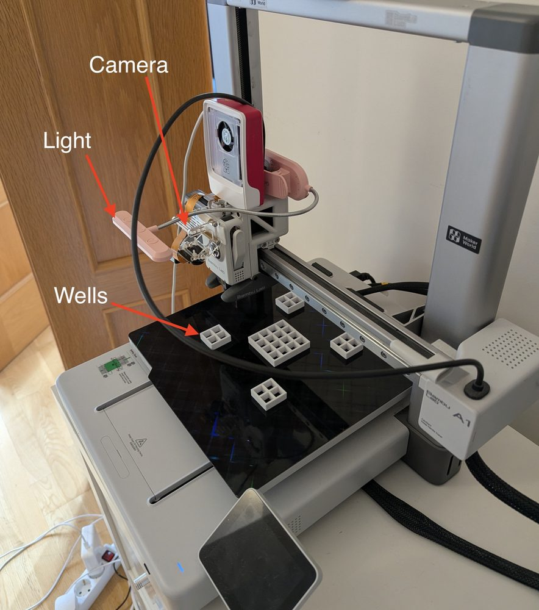
  &nbsp;
  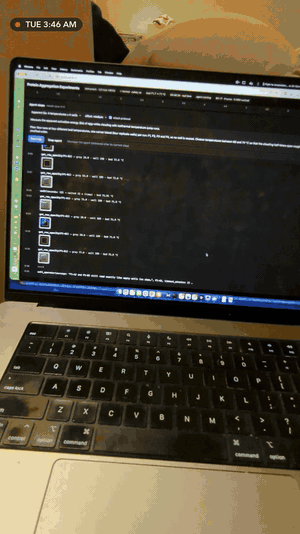

---

## The rig

| The cast | |
|---|---|
| 🖨️ **The robot** | A Bambu Lab A1 3D printer. Its moving head carries the camera around, and its heated bed is the "hot plate" (capped at 100 °C). |
| 📷 **The eye** | A Raspberry Pi camera from my drawer, glued next to the printer nozzle, plus a battery LED bar for light. It looks down into one well at a time. |
| 🧫 **The "lab plate"** | A grid of open-bottom wells that I 3D printed on the same printer: five little islands, 32 wells, 10 mm openings. |
| 🥚 **The sample** | Egg white. Clear when raw, cloudy when cooked. The camera measures how bright each well gets. |
| 🤖 **The scientist** | Claude Opus 5.5, running in a small Python harness I wrote. |
| 🧍 **The lab tech** | Me. The agent asks me to pipette egg white into specific wells. (Foreshadowing.) |

  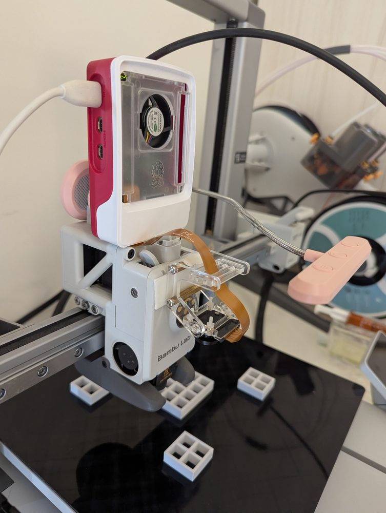
  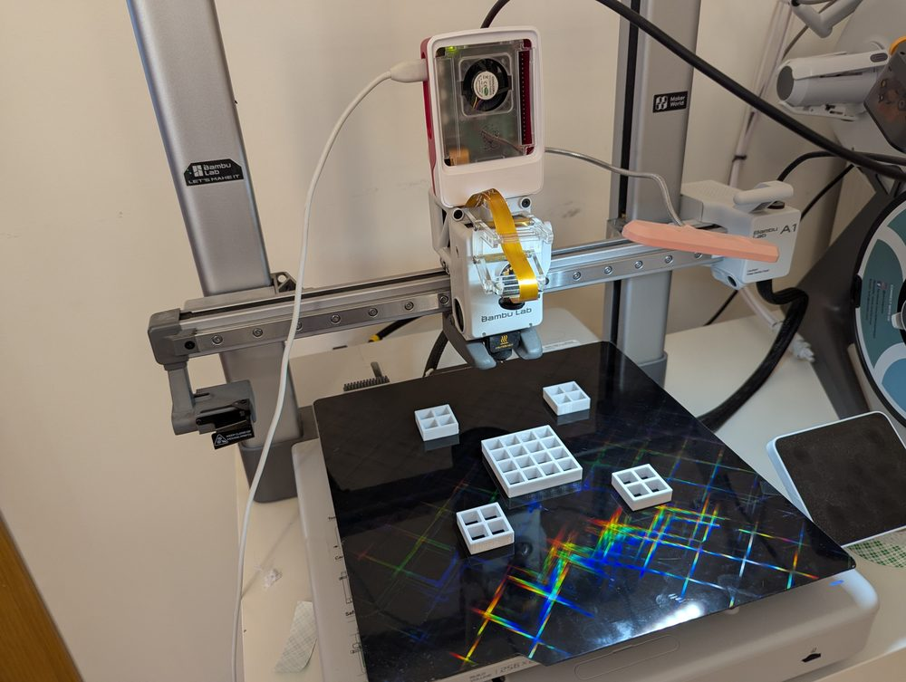

The camera mount (it moved twice, so now there's glue and a drift tracker) · The bed makes rainbows, which is pretty and terrible for measurements, so all the room lights go off.

## What the agent actually sees

The agent never touches motors or G-code. It gets a handful of lab-sized tools: *set the temperature*,
*ask the human to load a well*, *measure well P1-A1*, *call the human for help*. Behind the scenes a hardware
service turns "measure P1-A1" into: move the camera to the right spot, wait until the image stops wobbling,
take a photo, ignore the reflections, and return a number plus the picture.

  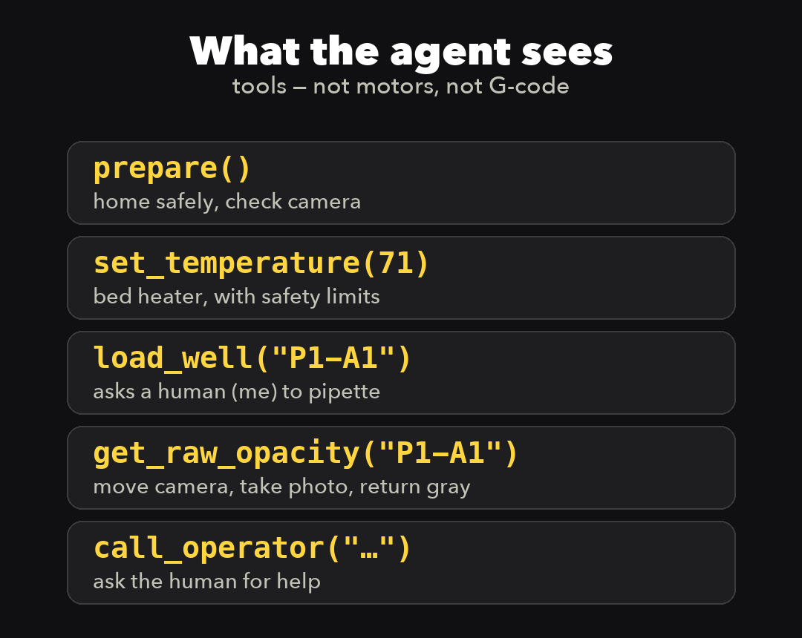
  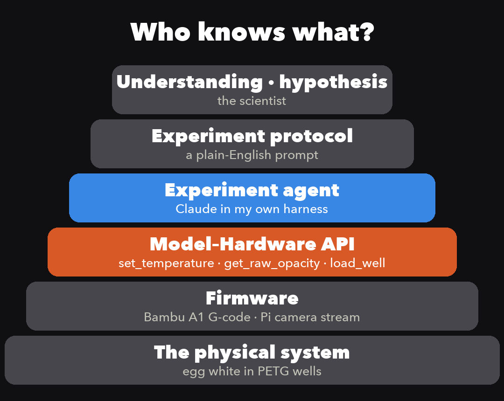

The idea in the right-hand picture: science has layers. Hypotheses at the top, a protocol, sub-tasks, robot control,
and finally the actual goo. Each layer needs to know a bit about its neighbours, not everything. The
**Model–Hardware API** sits between "do the experiment" and "move the nozzle to X 177.6, Y 115.2".

## The 3:47 AM moment

At 3:41 AM on a Tuesday, the agent planned four runs at four temperatures and asked me to fill four wells with egg white.
I filled two. Then it jumped the bed to 71 °C and started measuring.

  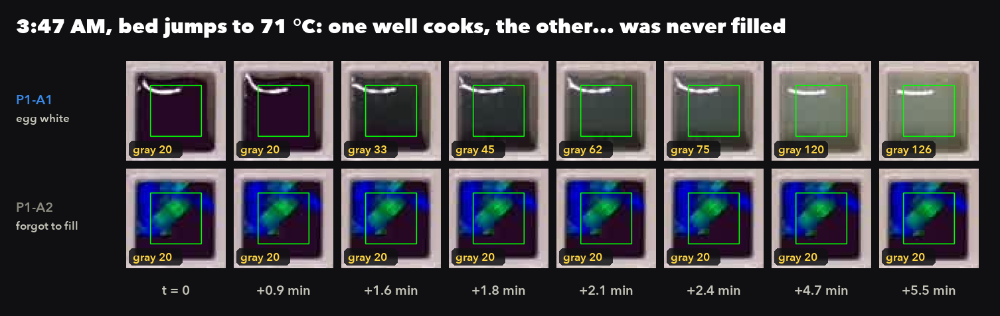

Two wells clouded up beautifully. Two stayed exactly as dark as an empty well. A script wouldn't care. The agent did,
and it called me:

> **call_operator:** *"P1-A2 and P1-B2 still read exactly like empty wells (no change) while P1-A1/B1 are clouding
> at 71 °C. Please look: do P1-A2 and P1-B2 actually contain egg white (no bubble/dry well)? Tell me what you see;
> don't refill unless empty."*

I confessed. It wrote a note, dropped the two wells, carried on with n = 2, and re-planned the remaining
temperatures because 71 °C turned out to be faster than expected.

  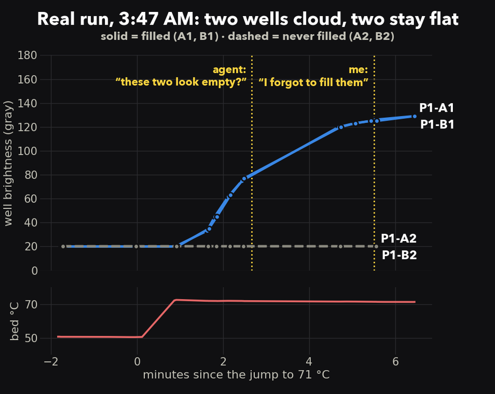

## Writing the loop vs. being in it

This is the whole point of the project. On day 1, before the harness existed, I asked Claude Code to run the same kind of
experiment. It did what coding agents do brilliantly: it wrote a solid Python script, and the script ran the
loop. It worked! Except one well was only half-filled, and nobody (no model, no script) ever looked at the frames.
I only noticed by peering at the wells myself.

  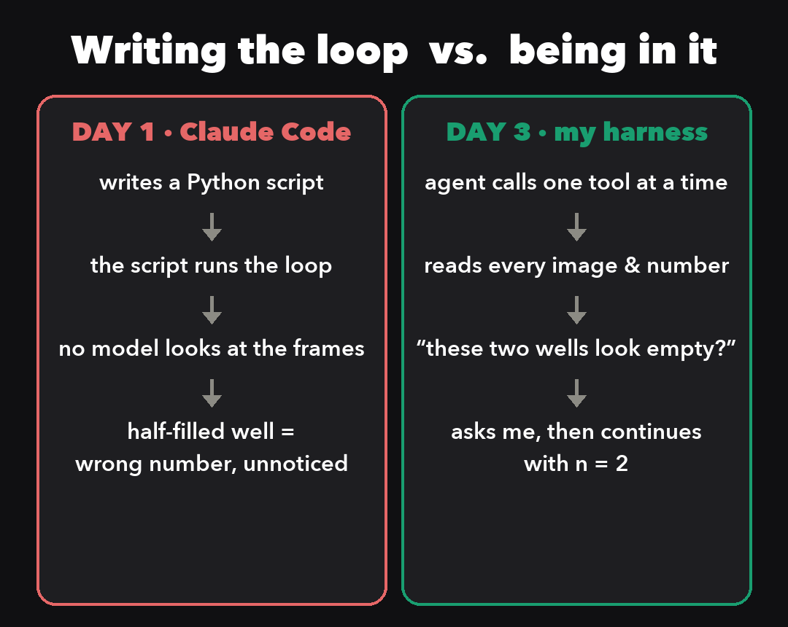

Coding is a great environment for "write the loop, run the loop". The physical world is messier. Wells don't
get filled, lights flicker, cameras slide on their glue. Making the model take each measurement itself costs more
compute, but it keeps its reasoning attached to what's actually happening on the bed.

## The digital twin (go play with it)

Before touching real hardware, everything ran against a **digital twin**: a simulated printer, camera, heater and
egg-white chemistry behind the exact same API. The agent can't tell the difference (that's the idea). Same tools,
same dashboard, fake eggs.

**👉 [34-9-34-15.sslip.io](https://34-9-34-15.sslip.io/)**: watch a recorded run or start your own. The agent
plans the experiment, "loads" wells (a simulated lab tech does the pipetting), measures, and fits the data.

  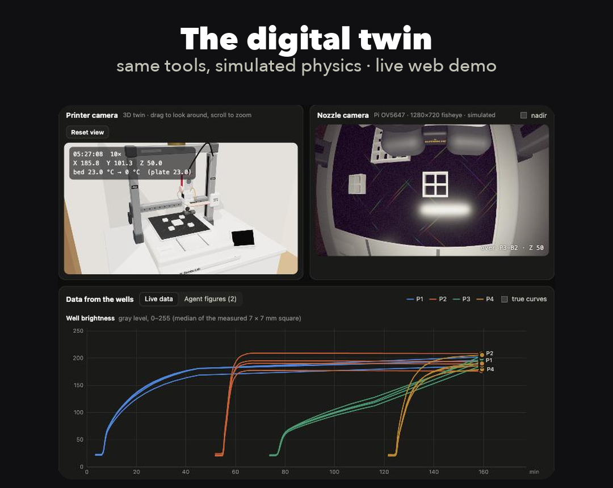
  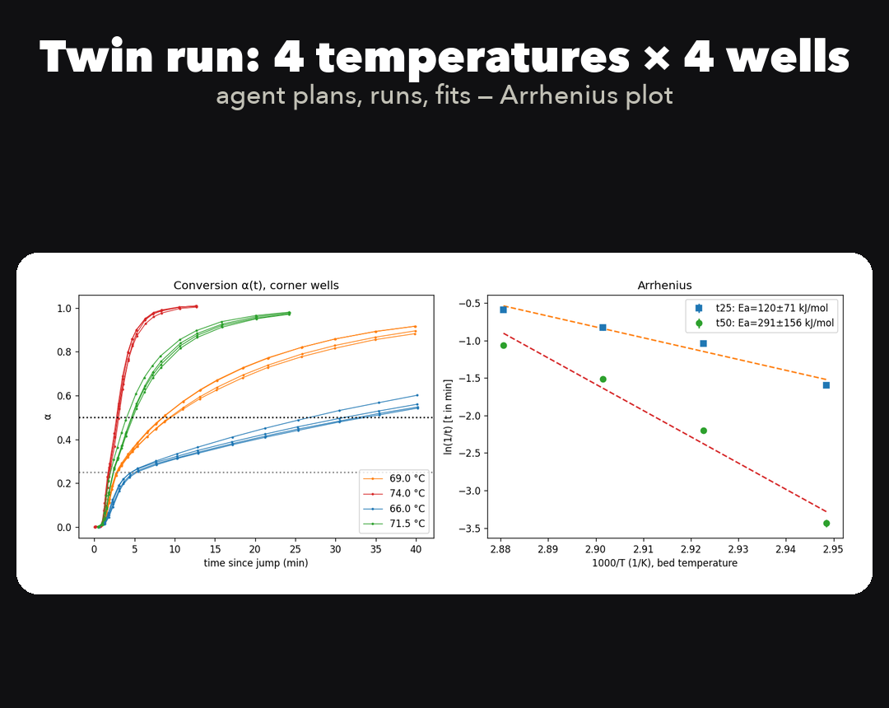

Left: the dashboard: a 3D printer you can spin around, the simulated nozzle camera and the live data. Right: a full twin run, 4 temperatures × 4 wells, ending in an Arrhenius plot that the agent fitted itself (the error bars are honest).

## Highlights from the blooper reel

- 🧱 **The first well grid print failed.** The grid on the bed now is design number five-ish.
- 📷 **The camera mount moved. Twice.** It crept about 1 mm in 30 minutes, then swung 10 mm while the head went up and down.
  Fix: glue, plus code that checks every frame for camera drift against a reference image of the toolhead.
- 💡 **Room lights flicker** at mains frequency, which the camera reads as noise. Fix: lights off, and exposures that
  are a whole number of flicker periods.
- 🌗 **Mid-run, the lighting changed.** The agent noticed the well *walls* got darker too, concluded "not a sample
  change", and normalised the data. Unprompted.
- 📡 **At 4:01 AM the printer dropped off the network.** The safety layer switched the heater off and halted, and the agent
  called for the human. The human was not answering at 4:01 AM.
- 🏠 **Never send a plain `G28`.** The printer's homing routine pokes the nozzle into the bed center, which is exactly
  where the middle well island lives. Homing now happens on bare steel in the back corner.

## Safety, because there's a hot plate and a sleeping human

The agent is treated as an untrusted planner. All the limits live in the hardware service, not in the prompt:
it refuses temperatures above 100 °C, cuts the heater on overshoot, lost contact or 15 minutes of agent silence,
allows only a short list of G-code, won't move while the human is loading wells, and won't ask for loading on a
bed above 60 °C. A separate tiny watchdog process turns the heater off if the service itself dies.
Details in [Hardware_Safety_spec.md](Hardware_Safety_spec.md).

## What's in here

| Folder | What it is |
|---|---|
| [`mhapi/`](mhapi/README.md) | The Model–Hardware API: hardware service, CLI, simulator, safety rules |
| [`harness/`](harness/README.md) + [`dashboard/`](dashboard/) | The agent loop (Claude + tools + run recording) and the web dashboard |
| [`twin/`](twin/README.md) | The digital twin: printer, optics, heater and egg-white kinetics |
| [`bambu/`](bambu/README.md) | Low-level printer and camera scripts, calibration, well-grid designs |
| [`calibration/`](calibration/) | Where every well is, and where "straight down" is for a tilted camera |
| [`deploy/`](deploy/README.md) | How the public simulation is hosted |
| [Model_Hardware_API_spec.md](Model_Hardware_API_spec.md) | The spec most of the code was written from |
| [experiment_protocol.md](experiment_protocol.md) | The egg-white protocol the agent follows |

This is a personal project, built for fun, not a polished library. It's very much wired to *my* printer,
*my* camera and *my* kitchen-table lighting.

## What I'd do next

- **Let the abstraction move.** The tool boundary here is hand-made. I'd like a system that decides on the fly
  what the LLM should reason about and what can safely be code. Maybe a cheaper model runs the hardware layer while
  the expensive one does the science. (Hi, Bitter Lesson.)
- **A safety agent.** An always-on second loop that watches across all the layers for things nobody thought to
  hard-code. The spec is written, the code isn't.
- **Run it above 80 °C** and see whether the PETG well grid survives. (Unclear. Exciting.)

---

Built by Sina Shahandeh in October 2026 with a lot of help from Claude Code. I'm a theoretical and computational scientist who
misses lab benches. This project took me back to teenage DIY days, something I've picked up again playing with my kids.
Watching Claude move the printer, look through the camera and reason about what it saw was genuinely magical.
At one point it spotted me in the printer's side camera and figured out it must be me.
