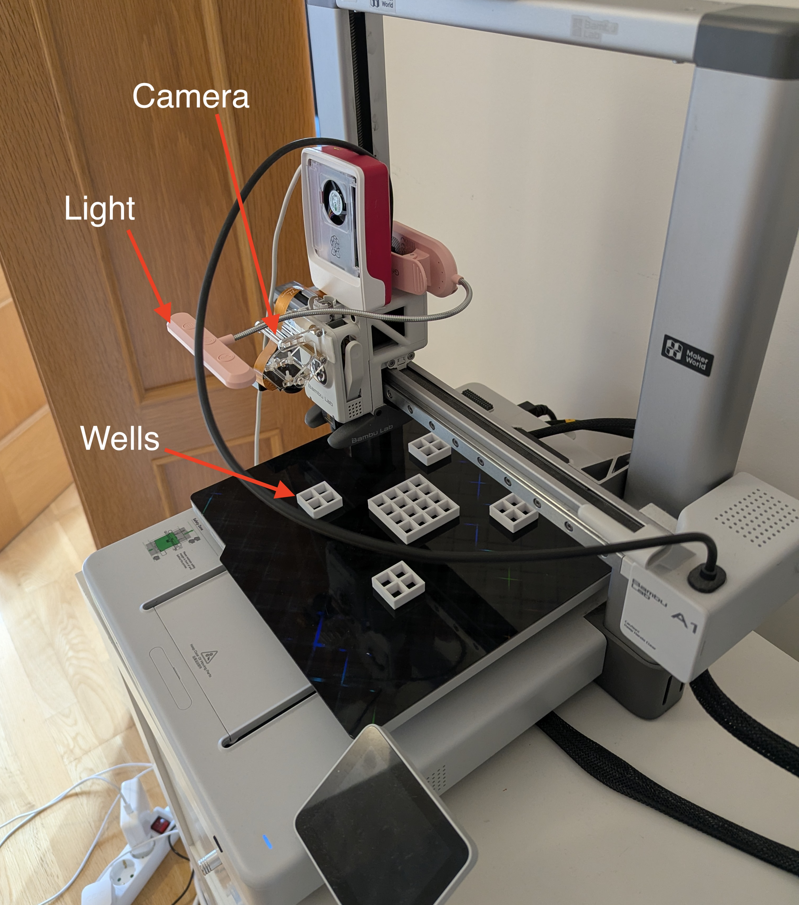

# Building an AI agent harness for conducting scientific experiments
Exploring heat-induced aggregation of egg-white proteins

## Design Rationale
In this short project, I have built a complete end to end setup of an AI agent interacting with physical world and conducting a scientific experiment. The idea is to convert a 3D-printer to a robotic experimentation platform and have an AI agent autonomously control the movement of a camera installed on its head as well as temperature of its bed (Fig 1.) This setup allows investigation of heat-induced phenomenon while the camera can measure color or opacity changes in the materials placed on the bed. Given the temperature range available on the 3D printer I decided to investigate kinetics of aggregation of protein molecules present in egg white. Heat induced changes in protien structure is an important scientific topic both in drug design and delivery as well as in food science.

But for this project, the important topic is the design of the system end to end. Although current coding agents are able to write scripts to control a 3D printer or a robot. They are not fundamentally "in the loop" during the scientific experiment. Claude Code can write a scipt to move a robotic setup and use camera to take a photo and get feedback from the environment. However this system is fragile, hard to implement safety checks coming from the hardware as well has hard to scale. It is cumbersome for the AI agent to maintain the low level derivers for robot control and this would limit the context of how many instruments and length of the experiment. We need abstractions to separate the actual work of conducting the scientific experiment from hardware control. Conducting scientific experiments has a hierarchal dynamic that is different tasks such as coding. Fig 2 shows this schematic hierarchy. 

               | Understanding |

        |  Scientific Hypothesis |

         (abstract tasks ↑ )  (observation ↑)

      | ---- Experiment protocol design ---- |

           Experimental Agent (tasks ↓)     (experimental results ↑)
    
    | --- Collection of Experimental sub-tasks --- |
         
          Model-Harware API      (abstract actions ↓)    (science metrics ↑)

  |  --- Robot hardware control to run each individual task ---- |

       Firmware:  (actuation ↓)   (environment sensing ↑) 

| -------------- The physical system under study -------------------|

An agent performing at any of the level needs specific informations about the layers above and below but not all. Orchestration of activities across the layers also important. The following is my design decisions for building this robotic experimentation system:

1- Build a custom AI agent harness as a python backend. This would hold the context about system setup and tools as system prompt and the experiment protocol as the first user prompt. The harness, calls the model API to decide which tools to call and how to present experiment results. This harness runs in python 

2- Build a Model-Harware API (M-HAPI) protocol; an interface between the robotic control and the experiment sub-tasks. The needs for this abstraction is quite clean given the robotic hardware interacts with the world using its own firmware and exposes basic fundamental action blocks (move the nozzle to x,y,z position). This is too low level for the experimental subtask. The recent Model Hardware Standard announced (but not released at the time of writing this document) aims at the same problem. In my Model-Harware API, I prompted Claude Code to explore the documentation for the BambuLab 3D printer and a camera connected to Raspberry Pi and setup basic primitives such as set_temperature() or get_well_opacity_measurement( well_label). The spec documentation and exploring and fixing hardware issues took a significant time for this project. A reliable and well designed Model-Hardware Interface is very crucial. 

3- Build a digital twin of the system to test the harness and M-HAPI together before running physical experiments. A well designed and scoped digital twin can uncover mistakes and shortcomings before using the hardware systems. This simulated environment interfaces with the same M-HAPI and tries to mimic as much physics as possible in the core simulation engine. You can see this this working as a experiment dashboard at https://34-9-34-15.sslip.io/

This web app interfaces with the agent harness that runs in the background as well as the simulation engine and twins the entire system end to end. 

In the video you will see the same dashboard is connected with the robot hardware and show the actual camera feeds and experimental data coming from the rig.

## Significance of this project and Further work direction

What I showed here is a simple yet complete example of end-to-end system running and AI agent in an experimentation platform and putting an LLM in the loop with the physical system. The significance of this work is this very abstraction and how we put the LLM in the loop. Let me explain by showing you a contrasting example. As I was experimenting with the M-HAPI, I asked Claude Code to control the setup directly and obtain kinetic coefficient or protien aggregation (rathe of egg white whitening). CC wrote a script to run this experiment loop and the robot executed it with no issues. I later realized the egg white was not completely filled the well so the measurements of opacity would be off. This mistake would have not been discovered have I not looked at the wells manually. This is because the LLM reasoning was not inside the loop for every frame. Claude did not look at every well as it was conducting the experiment but -- with a wrong abstraction -- it outsourced the loop to an automated script. This is a similar pattern as is used in a coding environment and the model is post-trained for it very well. The coding env does not have the variability that exists in the physical world.
In contrast, while I was conducting the same experiment with the custom harness. The agent asked me to fill 4 wells and I forgot to fill 2. Given that the LLM had to set the temperature, take a photo of each well and get opacity number using a M-HAPI tool call not write a code, This induced the model to reason about each image and be constantly inside the experimental observations, obviously resulting in more test-time compute cost.

And this brings us to the first immediate further work direction, what is the optimal level of abstraction across the 6 levels of the pyramid we discussed in Fig. ? . I am actually not satisfied with the current hard-coded version of M-HAPI. As I also read Anthropic's Model Harware Standard, it appears an AI agent interviews the scientist on how to setup but this is a one-time process. The better version would be an adaptive system that adjust the boundaries of agentic, LLM reasoned work with a hard-coded abstraction. Or I can imagine that M-H interface itself be run dynamically with a faster/cheaper LLM rather than code, where LLM produces code on the fly or uses some sort of domain specific language to execute hardware commands. This allows the harness to adapt to the complexity and noise of the physical system as well as the trajectories of experimentation can be used directly to post-train the LLM to adapt to the scientific tasks. Learning from the bitter lesson, one should try to avoid hand-crafting abstractions between the levels but let the model to dynamically pay attention to high and low level component of the experimental loop and use sub-agent processes. That is how a scientist moves between understanding at the high level to kneeling down the instruments and fixing the apparatus setup.

Certain safety measures was incorporated into the M-HAPI, e.g. bed temperature can be set to more than 100 C. But thinking about all safety issues and hard-coding them into the API layers is not the most flexible, not also robust. I can imagine a separate alway-on agentic loop running across the abstraction layers and monitor for various safety issues with a system prompt that is broad and guides it but not spefifying ridid details. I wrote the spec for this but have no time to implement and test.

## Time spent and logistics

The most time consuming part of this project was to build the physical setup, I had to retrofit the 3D printer, glue a camera to the filament nozzle and test and calibrate the light, fixtures to be able to measure opacity of egg white inside each well. The coding task itself was mostly writing the spec documents for the Model-Hardware API and the harness (3 hours). Once the spec and setup was clean and accurate Claude one-shotted most of the code. Testing was another 1-2 hours and writing this document another 1.5 hour. I have to yet edit the movie I took during the experiment that should take 30 min.

## Final words

This was a very fun project, I am a theoretical/computational scientist but love working and dealign with physical labs and instruments. This project brought me back to the time I was a teenager and doing DIY projects. Something that I have picked up playing with my kids now as well. 

It was beautiful and magical to see Claude controlling the printer, looking at the camera and reason. In one session it saw me inside the printer side camera and recognized it should be me.
We are at the onset of another Claude Code moment but instead of coding for complete scientific tasks. 
As we develop a more capable models and harnesses for science, safety issues across the lab and model execution as well as broader use of the AI tools for science at high level becomes even more important. We should take these concerns at the same time the tooling and post-training are performed on the model rather than an after thought at the time of deployment.

